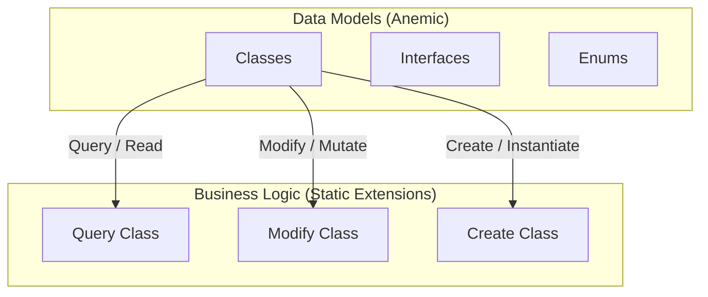

# DiGi.GIS.PostgreSQL

**DiGi.GIS.PostgreSQL** is a C# engineering and architectural software library suite designed for BIM and CAD integrations (such as Revit, RhinoCommon, Grasshopper, and Dynamo BIM).

---

## 🏗️ Project Architecture & Assemblies

The repository contains the following core components and assemblies:
* **[DiGi.GIS.PostgreSQL](DiGi.GIS.PostgreSQL)** (Path: `DiGi.GIS.PostgreSQL\DiGi.GIS.PostgreSQL`)

---

## 📐 Core Architectural Pattern (DiGi.Core Pattern)

This project strictly separates **Data Models** (anemic schemas) from **Business/Calculation Logic** (static extension methods). All new features must strictly follow this pattern.



### 1. Data Models (Classes, Interfaces, Enums)
* **Classes:** Place in the `/Classes` directory (Namespace: `[Project].Classes`). Keep them simple and lightweight (properties and basic constructors only). **Do NOT** put complex logic inside these classes.
* **Interfaces:** Place in the `/Interfaces` directory (Namespace: `[Project].Interfaces`).
* **Enums:** Place in the `/Enums` directory (Namespace: `[Project].Enums`).

### 2. Business Logic (Extension Methods)
ALL complex functionalities, including operations on classes, interfaces, and enums, MUST be implemented as **Extension Methods** inside static partial classes in `/Query`, `/Modify`, `/Create`, or `/Convert` directories:
* **Query (Read/Extract):** Static partial class `Query` returning results based on a query without modifying the source object.
* **Modify (Update/Mutate):** Static partial class `Modify` modifying the state or properties of the existing object in place.
* **Create (Instantiate):** Static partial class `Create` instantiating and returning a new object.
* **Convert (Parse/Format/Transform):** Static partial class `Convert` converting, formatting, or transforming an object into another representation.

---

## 🔌 PostgreSQL Converter Registration

Converters in this project must be explicitly registered in `Create\GISPostgreSQLConverterManager.cs`. This factory method reads `PostgreSQL_Main` and `PostgreSQL_Storage` configuration files and manually instantiates each converter.

The GIS WebAPI project's `InitializeAsync` reads converters from the returned `GISPostgreSQLConverterManager` and registers them in the DI container. WebAPI controllers (e.g. `BuildingController`) depend on these converters via constructor injection.

**When adding a new converter that will be consumed by a GIS WebAPI controller:**
1. Add its instantiation to `Create\GISPostgreSQLConverterManager.cs` under the appropriate configuration file section.
2. If a converter is missing from this registration, the corresponding controller will receive a `null` dependency, causing a `NullReferenceException` and a **500 Internal Server Error** at runtime.

---

## 🗃️ How Building Data Is Referenced

Everything stored about a building is addressed at **two levels**. Getting this wrong is the single
easiest way to silently destroy data in this repository, so read it before touching any table created
through `Create.TableAsync_Building2DReferencedObject`.

| To address | Use | Meaning |
|---|---|---|
| A building, and so **all** data held for it | `(county_id, reference)` | The building itself |
| **One stored object** within that data | `unique_id` | The object's own identifier |

### The building key: `(county_id, reference)`

* **`reference`** is the BDOT10k `<ot:lokalnyId>` of the building, taken from the source XML.
* **`county_id`** is the `id` of the county row in `administrative_areal_2d` — **the identifier, never
  the county code.** A code maps to one row per polygon part (18 of Poland's 380 counties have
  disconnected territory, giving 406 county rows), so a code is not a key.
* **`building_2d` is the source of truth** for the pair and constrains it `UNIQUE (reference, county_id)`.
  The combination is constrained per partition at the database level due to PostgreSQL partition requirements.

Every table holding building-related data carries both columns. To read a building's data: take
`reference` and `county_id` from `building_2d`, then select every row in the target table with the same
pair.

### 📊 Nationwide Building Reference Uniqueness Audit & Findings

A comprehensive nationwide audit across all **406 county parts (380 administrative counties)** in Poland established the empirical uniqueness of the `reference` column:

| Metric | Measured Value |
|---|---|
| **Total County Parts Analyzed** | **406** |
| **County Parts Containing Buildings** | **383** |
| **Total Building Records Nationally** | **15,822,187** |
| **Total Unique References** | **15,822,187** |
| **Cross-County Duplicate Collisions** | **0** |
| **Empirical Global Uniqueness Rate** | **100.0%** |

#### Key Conclusions
1. **Empirical Global Uniqueness:** In practice, all 15,822,187 building references (`ot:lokalnyId`) in Poland are **100% globally unique across the entire country**. The underlying BDOT10k identifiers generated by geodetic agencies (PZGiK) follow universal GUID/UUID schemes with zero cross-county collisions.
2. **Schema vs. Partitioning Design:** The database constraint is scoped to `UNIQUE (reference, county_id)` because PostgreSQL requires the partition key (`county_id`) to be included in any unique index on a partitioned table.
3. **Historical Duplicates Resolved:** The 86,196 duplicate rows identified on 2026-08-14 were intra-county part filing artifacts across multi-part counties and have been completely eliminated by `PostgreSQLBuilding2DCountyPartRepairTask`.
4. **Diagnostic WebAPI Endpoints:**
   - `GET /gis/building2d/referenceduplicates?limit=100`: Returns cross-county collision details.
   - `GET /gis/building2d/referenceuniquenesssummary`: Returns nationwide total, distinct, and duplicate counts.
   - `POST /gis/buildingdata/aggregatesummary/singlevalue`: Supports nationwide aggregations when `CountyId` is omitted.

### The row key: `unique_id`

`unique_id` holds the identifier of **the stored object itself** — for a `GuidObject`, its guid — not the
reference of the building it describes.

**A building may legitimately hold several rows in one table.** Occupancy, for instance, can be
recorded several times for one building, computed on different days or under different rules. The table
therefore constrains `UNIQUE (county_id, unique_id)` and places **no** constraint on
`(county_id, reference)`.

### What that means when you write code

Writes **append by default**: storing an object that was built fresh adds a row; only an object read
back from the database, which kept its identifier, replaces its own row.

```
Read a building's data     GetItemsByReferenceAsync(reference, countyId)      -> every row held for it
Read the newest record     GetItemByReferenceAsync(reference, countyId)       -> most recently stored only
Delete a building's data   RemoveAsync(references, countyId)                  -> the whole set
Delete one object          RemoveByUniqueIdsAsync(uniqueIds, reference, countyId)
Update one object          read the set -> find it -> remove by unique_id -> add the replacement
```

There is no upsert that targets a single object, and the API read endpoints are named
`itemsbyreference` (plural) because they return a list.

> [!WARNING]
> **Do not key a row on the reference to make writes idempotent.** A table that grows on every run
> looks like a bug, and setting `unique_id = reference` appears to fix it. It does not — it pins the
> table to one row per building and silently discards every record after the first. If a re-run should
> replace data, delete it first.

Reference types: `Classes/Building2DReferencedObject.cs` (the convention in full),
`Classes/Converter/Building2DReferencedObjectPostgreSQLConverter.cs` (the read/write/remove methods),
`Create/TableAsync.cs` (the DDL that enforces it). County handling is covered in detail by
`AI Guidelines/Coding - GIS Administrative Data.md`.

---

## ⚠️ Known Limitations

### `terrain_point` — elevation service no-data sentinel handling

GUGiK NMT answers `0` with HTTP 200 for coordinates it holds no terrain model for. `Query.ElevationAsync`
treats `0` as an unresolved no-data sentinel (`null`) rather than a measurement, preventing artificial sea-level
plateaus over water bodies or across national borders. Stored zero points can be purged using
`TerrainPointPostgreSQLConverter.DeleteZeroElevationsAsync`.

Resolved in [#25](https://github.com/DiGi-Organization/DiGi.GIS.PostgreSQL/issues/25).

---

### Terrain coverage walks — single-connection reuse across tiles

`GetCoverageByCountyIdAsync` (served as `gis/terrain/coveragebycountyid`, and shared by
`gis/terrain/gapsbyboundingbox`) measures a county against the lattice in tiles. The request reuses
a single open `NpgsqlConnection` across all tile queries in the county walk rather than opening and
closing connections per tile, avoiding connection pool churn and exhaustion under concurrent load.

---

## 💻 Coding Guidelines for Developers & AI Agents

All developers and AI agents follow these always-applicable rules (Visual Studio 2026, C#). Task-specific detail lives in
the guidelines listed in §9 — read the one matching the task.

### 1. General coding standards
1. **English only** — identifiers and comments.
2. **No `var`** unless the compiler forces it; target-typed `new()` (`PointNode pointNode = new();`, avoids IDE0090) and
   collection expressions (`List<int> numbers = [];`, avoids IDE0028).
3. **Naming:** camelCase starting with the type name, `_`-suffixed qualifier when needed (`PointNode pointNode_Base`); an
   acronym type lowercases only its first letter (`gISPostgreSQLConverterManager`). Collections: pluralized element type
   (`filterConditions`, `point3Ds` — not `listConditions`). A property named after its unique, descriptive type
   (`public AggregateFunction AggregateFunction { get; set; }`). Primitives: plain camelCase.
4. **Zero warnings/analyzer messages.**
5. **Block-scoped namespaces** (`namespace DiGi.Domain { ... }`); file-scoped are prohibited (`.editorconfig`). The template
   pins `LangVersion` 12; most repositories use `latest`, core libraries target `netstandard2.0` — use
   `System.Threading.Lock` only in net9+ projects at C# 13+.
6. **Parameter line breaks (`<= 7` rule, `DIGI0001`):** ≤ 7 parameters on one line however long; ≥ 8 one per line. Line
   length is never the trigger. Call sites prefer one line; multi-line for complex expressions, lambdas, initializers.
   ```csharp
   public void Calculate(double centerX, double centerY, double radius, double? storeyHeight = null)
   ```
7. **Async method names end with `Async`.**
8. **`CancellationToken` is always the LAST parameter (CA1068)** — every method and overload; add new optional parameters
   before it and reorder the `<param>` tags. At call sites **name every argument after a skipped default**
   (`commandTimeout: 30`, `cancellationToken: cancellationToken`) so an inserted parameter fails to compile instead of
   rebinding. Detect: `grep -rnE "CancellationToken [a-zA-Z_]+( = default)?, " --include=*.cs .`
   ```csharp
   public static async Task<bool> ClearAsync(NpgsqlConnection? npgsqlConnection, string tableName, int commandTimeout = 30, CancellationToken cancellationToken = default)
   ```
9. **Simplify member access (IDE0002) — then rebuild.** C# binds the first segment innermost-outwards with no fallback:
   from `DiGi.GIS.PostgreSQL.UI.Classes`, `WebAPI` is `DiGi.GIS.WebAPI`, so `DiGi.WebAPI.Query.GetAsync` keeps its prefix.
   When same-named extension methods can both apply, call the intended one fully qualified — the `using` decides silently.
10. **Separate projects**, not one monolithic solution.
11. **Output optimization:** no filler; only the necessary code, logic or explanation.
12. **Temporary code carries `TODO [MarkerName]:`** — a PascalCase name of the **migration**, reused at every site so one
    `grep` is the deletion checklist, stating the observable **removal condition** and the tracking issue. A workaround
    for another DiGi repository's defect is temporary too (removal condition = the upstream fix). Never tag permanent code.
13. **`ToString()` is not a key** — identity strings render through `CultureInfo.InvariantCulture` (`"R"` with `-0.0`
    folded, `G29` for `decimal`); `pl-PL` files `[0,5, 12,25]` and nothing throws. Reference: `DiGi.Typology.Visual.Query.Key`.
14. **A member resolved by name through reflection is a contract on the whole hierarchy** — document it at both ends,
    probe `GetMethod` rather than reason about it.
15. **No caching in an optimization unless the request explicitly allows it** — remove allocations and repeated
    enumeration first; propose a cache with its measurement and ask.
16. **Log through `Serilog.Modify.Log`** with structured templates (`"{Type}: … {CountyId}"`, never interpolation);
    `Log(exception, …)` always logs at Error.
17. **Rethrow only a requested cancellation:**
    `catch (OperationCanceledException) when (cancellationToken.IsCancellationRequested) { throw; }` before any general catch.

### 2. Architecture (DiGi.Core pattern)
Data models are anemic; behavior is static extension methods. Never a service/manager class for behavior (process-wide
registries are `*Manager`s on `Settings` or DI singletons).
- **`/Classes`** (`[Project].Classes`), **`/Interfaces`**, **`/Enums`**. Category folders (`Classes/Options`,
  `/BackgroundTask`, `/Result`, `Convert/ToX`) add **no** namespace segment — it would change the `_type` discriminator.
- **`Query`** (read-only, property-like names: `BoundingBox()`, only `Is`/`Has`/`Try` prefixes), **`Modify`** (mutates),
  **`Create`** (builds), **`Convert`** (`/Convert/To[TargetArea]/[TargetType].cs`, `ToSystem_String`, `ToEPW_DateTime`) —
  `Convert` is the first choice for any conversion, never an instance method on the model.
- **Interface-contract members are instance methods on the class** — geometry primitives (`Polygon2D`, `Circle2D`, …
  implementing `IBoundable2D`, `ITransformable2D`, `IClosedCurve2D`) are deliberately not anemic; never move them.
- **Constructors stay cheap** (assign and clone only); validation and cleanup go in a `Create` factory named after the
  type, returning `null` for invalid input — materialise → clean up → then validate.
- **One public method per file** in `/Query`, `/Modify`, `/Create` (overloads together); nested types in
  `[Outer].[Inner].cs`; **no private methods** in these classes (public helper or local function).
- **`IResult` types end in `Result`** (`TerrainPointDensityResult`); the name is wire contract, so existing violations are
  not renamed opportunistically.
- Enums start with `Undefined` (`-1` only where `0` is real); tolerances come from `DiGi.Core.Constants.Tolerance`
  (`Distance` 1e-6, `MicroDistance`, `MacroDistance`, `Angle`).

### 3. Project assets — `files/` vs `user files/` (never commit secrets)
Committed, non-sensitive deployment assets go in `files/`; **secrets, credentials, machine-specific settings and
generated reports go in the git-ignored `user files/`** (`[Uu]ser [Ff]iles/` in `.gitignore`; verify with
`git check-ignore -v "user files/x.conf"`). Both are copied flat into the output (`CopyUserFiles` runs after `CopyFiles`,
so `user files/` wins) — and `user files/` **ships** with every deploy, so training data and model variants live outside
the workspace. A file a build copies into a project (`gltf-viewer-core.js`, `gis-theme.css`) is edited only at its source.

### 4. Host dependencies — `HintPath` drops a library's NuGet packages
DiGi projects reference each other by `HintPath`, which NuGet and MSBuild cannot follow: a host must **re-declare every
package its libraries need, at the same version** (unless its framework provides it), or it fails at run time with a
`FileNotFoundException` per item — a **partial result reported as success**. `dotnet test` never rebuilds the library
under test: build it first. Verify with `CheckHostDependencies.ps1`.

### 5. References (`IReference` / `IUniqueReference`)
**Never compare two interface-typed references with `==`** (a silent reference comparison; accessors clone per call).
Use `Core.Query.Equals(reference_1, reference_2)`.

### 6. Serialization (`SerializableObject`)
A serializable class implements `I<Project>SerializableObject`, keeps `private readonly` fields tagged
`[JsonInclude, JsonPropertyName(nameof(Prop))]`, exposes them as `[JsonIgnore]` get-only properties, uses
`DateTimeOffset` for dates, and has exactly three constructors:
```csharp
public Holiday(string? name, string? date)
{
    this.name = name;
    this.date = date;
}

public Holiday(Holiday? holiday) : base(holiday)
{
    if (holiday != null)
    {
        name = holiday.name;
        date = holiday.date;
    }
}

public Holiday(JsonObject? jsonObject) : base(jsonObject) { }
```
Copy constructor: primitive lists `new List<T>(source)`, nested objects `Core.Query.Clone(item)` element by element.

### 7. Documentation and tests
- **XML docs:** every public member, params in signature order, one `<summary>`, no blank lines (`<para>`), no docs on
  `partial` declarations. Read `documentation/API/<Assembly>/` before opening `.cs` source.
- **xUnit:** `[ProjectName].xUnit`, `public partial class Facts` in `/Facts`, a `<summary>` on every fact, shared fixtures
  in `DiGi.Test/files/`, written reports in `DiGi.Test/user files/reports/`. Every serializable class gets a fact ending in
  `Core.xUnit.Query.SerializationCheck(instance)` **plus** a direct copy-constructor assertion. Tolerance facts test just
  inside and just outside; benchmarks are measured in isolation with a warm-up. Slow facts are `[MediumFact]`/`[LongFact]`.
- **Interactive front ends** are verified in a real browser (Playwright), asserting rendered output, not state flags.

### 8. Branches and releases
Work is committed on the active version branch (the highest bare SemVer branch, e.g. `0.8.5`) — no feature branch,
worktree or pull request unless asked; push only when asked. **A version bump / release runs only on an explicit request:**
merge the version branch into `main`, bump the patch (`0.8.2` → `0.8.3`), branch it off `main`, update
`Directory.Build.props` `<Major>`/`<Minor>`/`<Build>`, push both (`git push -u origin <version_branch>`).

### 9. Full guideline set
Canonical, task-specific guidelines live in `DiGi.Maintenance/documentation/AI Guidelines/` (relative to the workspace
root) and are mirrored per repository as skills under `.agents/skills/<skill-name>/SKILL.md`.

| Guideline | Read it when |
|---|---|
| `Coding - General.md` | Writing or editing any C# code. |
| `Coding - Serialization.md` | Creating or changing a serializable type or options class; debugging a JSON round trip. |
| `Coding - Host Dependencies.md` | Adding a NuGet package; a host failing with `FileNotFoundException` or a partial result; `CS0012`/`CS0246` build walls. |
| `Coding - Project Setup.md` | New project or repository, `.editorconfig`, `Directory.Build.props`, analyzers. |
| `Coding - Automatic Tests.md` | Writing xUnit facts. |
| `Coding - Performance.md` | Optimizing, benchmarks, parity tests, the wiki `Benchmark.md` page. |
| `Coding - References.md` | Comparing or keying an `IReference` / `IUniqueReference`. |
| `Coding - Geometry.md` | Orienting, closing, triangulating, hashing or sweeping geometry. |
| `Coding - ComputeSharp.md` | Writing or changing a ComputeSharp `IComputeShader`. |
| `Coding - Grasshopper.md` | Grasshopper/Rhino plug-in components. |
| `Coding - Background Tasks.md` | Tray-application background tasks and their dialogs. |
| `Coding - WPF Deferred Loading.md` | A WPF window needing slow data; WPF layout checks. |
| `Coding - YOLO.md` | The YOLO Year Built detector. |
| `Coding - Laya.md` | The Laya decision model. |
| `Coding - WebAPI GLTF.md` | Web APIs on the `DiGi.GLTF` 3D framework. |
| `Coding - WebAPI Contracts.md` | Changing a WebAPI route/parameter/controller or writing an HTTP client. |
| `Coding - WebAPI Simple Authorization.md` | API-key tiered authorization. |
| `Coding - Deployed WebAPI.md` | Testing against `api.digiproject.uk`; which server runs what. |
| `Coding - Browser Testing.md` | Verifying interactive front-end behaviour in a real browser. |
| `Coding - GIS Administrative Data.md` | Anything keyed by a county code or id; the Subdivision layer. |
| `Coding - PostgreSQL.md` | PostgreSQL/Npgsql code, production vs development databases. |
| `Coding - PostgreSQL Distributed Queue Processing.md` | Distributed claim/acknowledge update queues. |
| `XML Documentation.md` | Reading generated API docs; adding or auditing XML docs. |
| `GitHub - Branches and Commits.md` | Where to commit, the pre-commit sweep, plan files, pulling all repos, releases. |
| `GitHub - Issues.md` | Creating, editing, verifying and closing issues; dependencies. |
| `GitHub - Labels.md` | Labels and the mandatory `ai: *` tier. |
| `GitHub - Sub-Issues.md` | Sub-issues for a multi-repository feature. |
| `GitHub - Workspace Setup.md` | Folder layout and new-machine setup. |
| `GitHub Wiki.md` | Editing wiki pages. |
| `Maintenance - Scripts.md` | `DiGi.Maintenance/Scripts`; scripted edits and line endings. |
| `Maintenance - AI Guidelines Propagation.md` | Adding, splitting or removing a guideline. |

> **One data rule worth knowing before it bites you:** a GIS county `code` does **not** identify one row — 406 county
> rows (one per polygon part) cover 380 codes. Key every write and lookup by county **`id`**, give every
> `LIMIT`/`FirstOrDefault` an `ORDER BY`, never deduplicate those rows, resolve every item's part against `building_2d`
> whatever number of ids arrived, and read building-keyed tables with `fallbackByReference: true`
> (`Coding - GIS Administrative Data.md`).
